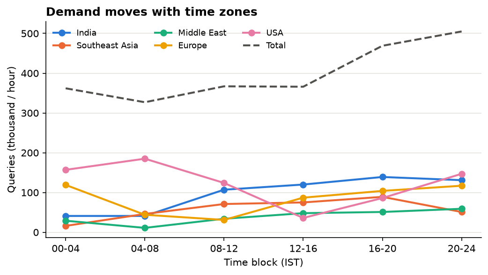
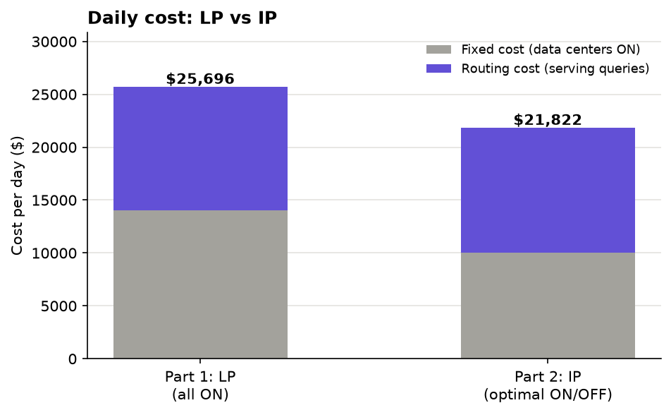
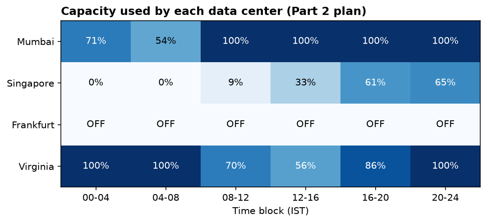
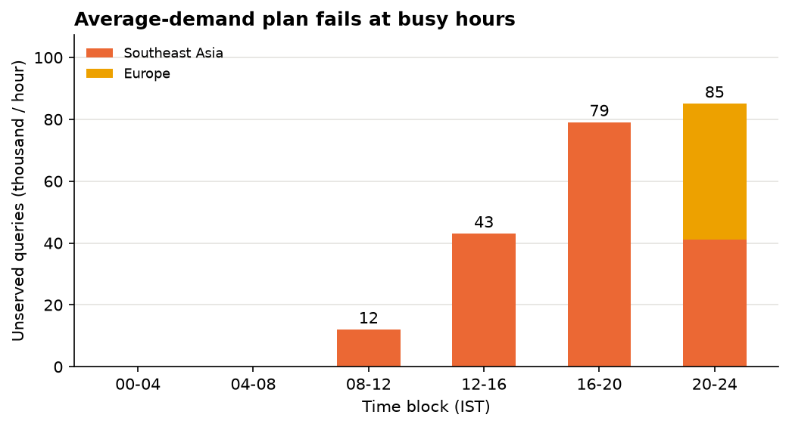

# 04 · Figures Guide

This guide explains **all four figures** in the `figures/` folder: what each one shows, how it is produced, how to read it, the exact numbers behind it, what it proves, and what to say about it in the viva.

> **Related guides**
> - [01_CODE_GUIDE.md](01_CODE_GUIDE.md): what every file contains
> - [02_PROBLEM_AND_SOLUTION.md](02_PROBLEM_AND_SOLUTION.md): the problem and the maths
> - [03_DEMO_GUIDE.md](03_DEMO_GUIDE.md): the live demo

---

## 0. How the figures are made

- Created by **`charts.py`** (matplotlib), called at the end of **`main.py`**.
- Regenerate them at any time:
  ```bash
  conda activate opr
  python main.py
  ```
- Saved as **PNG, 150 dpi** in `figures/` (the folder is created automatically). They are ready to paste into a report or slides.
- **Consistent colours:** each region always has the same colour in every figure and in the live demo:

| Region | Colour |
|---|---|
| India | Blue |
| Southeast Asia | Orange |
| Middle East | Green |
| Europe | Yellow |
| USA | Pink |

- **Common style** (the `clean()` helper): bold title on the left, no top or right border, light horizontal grid lines behind the data.

### The story the four figures tell together

| # | Figure | Question it answers |
|---|---|---|
| 1 | Demand curves | *What is the problem?* Demand moves around the world |
| 2 | Cost comparison | *What do we gain?* The IP saves 15% over the LP |
| 3 | Utilization | *What does the optimal plan look like?* Who works when |
| 4 | Static plan failure | *Why model time blocks?* The average plan fails at peaks |

---

## Figure 1: Demand moves with time zones

**File:** `figures/1_demand.png` · **Function:** `charts.demand_chart()`



### What it shows
- **X-axis:** the 6 time blocks of the day, in IST.
- **Y-axis:** queries in thousands per hour.
- **5 coloured lines with dots:** demand of each region in each block.
- **Dashed dark line:** **total demand** of all regions together.

### Data behind it (from `data.DEMAND`)

| Region | 00-04 | 04-08 | 08-12 | 12-16 | 16-20 | 20-24 |
|---|---|---|---|---|---|---|
| India | 41 | 41 | 107 | 120 | **139** | 131 |
| Southeast Asia | 16 | 46 | 71 | 75 | **89** | 51 |
| Middle East | 29 | 11 | 34 | 48 | 51 | **59** |
| Europe | **119** | 44 | 31 | 87 | 104 | 117 |
| USA | 157 | **185** | 124 | 36 | 86 | 147 |
| **Total** | 362 | 327 | 367 | 366 | 469 | **505** |

### How to read it
- The **pink USA line is highest at 04-08 IST** (185), which is evening in the USA, and **lowest at 12-16 IST** (36), the middle of the night there.
- The **blue India line is low at night (41)** and **peaks at 16-20 IST (139)**.
- **Europe (yellow)** is high around midnight IST (its evening) and lowest at 08-12 IST (its early morning).
- The peaks of different regions **happen at different times**. That is the time-zone effect.
- The **total (dashed)** is fairly flat (327–367) until the afternoon, then rises to **505 at 20-24 IST**, when India, the Middle East and Europe are all busy and the USA is waking up.

### What it proves
1. Demand is **not constant**. It changes block by block.
2. When one region is quiet, another is busy, so spare capacity in one place can **help another region** (e.g. Mumbai helps Europe at night).
3. Capacity must be planned for the **peak (505)**, not the average (399).

### What to say in the viva
> *"Each region is busiest in its own local evening. Converted to Indian time, the peaks are spread across the day. The USA peaks at 4–8 am IST, India at 4–8 pm. Total demand peaks at 505 thousand queries per hour between 8 pm and midnight IST. This is why we model 6 time blocks instead of one average."*

---

## Figure 2: Daily cost, LP vs IP

**File:** `figures/2_cost_comparison.png` · **Function:** `charts.cost_chart(plans)`



### What it shows
- **Two stacked bars**, one per model:
  - **Left:** Part 1, Transportation **LP** (all data centers ON)
  - **Right:** Part 2, **Integer Programming** (optimal ON/OFF)
- **Grey part (bottom):** fixed cost of keeping data centers ON.
- **Purple part (top):** routing cost of actually serving queries.
- **Bold number on top:** total cost per day.

### Data behind it

| | Part 1: LP (all ON) | Part 2: IP (Frankfurt OFF) | Difference |
|---|---|---|---|
| Fixed cost | $14,000 | $10,000 | **−$4,000** |
| Routing cost | $11,696 | $11,822 | **+$126** |
| **Total** | **$25,696** | **$21,822** | **−$3,874 (−15.1%)** |

### How to read it
- The **grey part shrinks a lot** ($14,000 → $10,000): Frankfurt's $4,000 fixed cost disappears.
- The **purple part is almost the same height** ($11,696 → $11,822): serving Frankfurt's small share from other sites costs only $126 more.
- So the **total drops by $3,874 per day**, which is about **$1.4 million per year**.

### What it proves
- **Integer programming adds real value** over plain LP: the LP has no way to say "switch it off".
- The trade-off is visible in one picture: a **small** increase in routing cost against a **big** saving in fixed cost.

### What to say in the viva
> *"The grey part is fixed cost, the purple part is routing cost. When the integer program is allowed to switch data centers off, it removes Frankfurt. The grey part drops by $4,000 while routing increases by only $126, a net saving of $3,874 a day, or 15%."*

---

## Figure 3: Capacity used by each data center (Part 2 plan)

**File:** `figures/3_utilization.png` · **Function:** `charts.utilization_chart(ip)`



### What it shows
- A **heat-map table**: rows = data centers, columns = time blocks (IST).
- Each cell = **% of that data center's capacity used** in that block in the optimal IP plan.
- **Darker blue = busier** (white = 0%, dark navy = 100%). Text turns white on dark cells for readability.
- **"OFF"** = the model switched that data center off for the whole day.

### Data behind it

| | 00-04 | 04-08 | 08-12 | 12-16 | 16-20 | 20-24 |
|---|---|---|---|---|---|---|
| Mumbai | 71% | 54% | **100%** | **100%** | **100%** | **100%** |
| Singapore | 0% | 0% | 9% | 33% | 61% | 65% |
| Frankfurt | OFF | OFF | OFF | OFF | OFF | OFF |
| Virginia | **100%** | **100%** | 70% | 56% | 86% | **100%** |

How each % is computed: `100 × load(dc, block) / CAPACITY[dc]`. For example Singapore at 20-24 serves India 34 + SE Asia 51 = 85 k/h, and 85 / 130 = **65%**.

### How to read it, row by row
- **Virginia** (cheapest, $0.90): full (100%) during the IST night, when the USA and Europe are awake. It is always heavily used because it is the cheapest.
- **Mumbai:** full from **8 am to midnight IST**, when India is awake. At night (71%, 54%) it has spare capacity, which it uses to **help Europe** (56 k/h at 00-04). This is "follow the sun".
- **Singapore:** **0% at night**, but needed in the afternoon and evening (33% → 65%) when Asia peaks and Mumbai is full.
- **Frankfurt:** OFF all day. Its work is absorbed by Virginia (Europe) and Mumbai.

### A question you may get: "Singapore is 0% at night. Why not switch it off?"
Because the ON/OFF decision is for the **whole day** (you can't close a data center every 4 hours). Singapore is essential from 08-12 onward: Mumbai is at 100% and Southeast Asia can only be served by Mumbai or Singapore. Without Singapore, SE Asian users would go unserved (see Figure 4).

### What it proves
- The optimal plan uses the **cheap sites to the maximum** (many 100% cells) and keeps an expensive site only where it is essential.
- **Capacity is the binding constraint** at peak times. The 100% cells are where extra capacity would reduce cost further.

### What to say in the viva
> *"This shows how full each data center is in every block of the optimal plan. Virginia and Mumbai, the two cheapest, run at 100% whenever their regions are awake. Singapore is only needed in the Asian afternoon and evening, but since the ON/OFF decision is daily, it stays on. Frankfurt is off all day."*

---

## Figure 4: Average-demand plan fails at busy hours

**File:** `figures/4_static_plan_failure.png` · **Function:** `charts.unserved_chart(test)`



### How this scenario is built (Step 4 in `main.py`)
1. Solve the IP using only the **daily average** demand (399 k/h, one 24-hour block).
   → Decision: keep **only Mumbai + Virginia** (capacity 420 ≥ 399). Cost on paper **$18,035/day**.
2. **Fix** that ON/OFF decision and solve again with the **real 6-block demand**, allowing unserved demand.
3. Plot the unserved demand.

### What it shows
- **X-axis:** time blocks (IST).
- **Y-axis:** unserved queries, thousand per hour.
- **Stacked bars coloured by region:** orange = Southeast Asia, yellow = Europe.
- **Number on top:** total unserved in that block.

### Data behind it

| Block | Southeast Asia | Europe | Total unserved (k/h) |
|---|---|---|---|
| 00-04 | 0 | 0 | 0 |
| 04-08 | 0 | 0 | 0 |
| 08-12 | 12 | 0 | **12** |
| 12-16 | 43 | 0 | **43** |
| 16-20 | 79 | 0 | **79** |
| 20-24 | 41 | 44 | **85** |
| **Day** | | | (12+43+79+85) × 4 h = **876 thousand queries** |

### Why exactly these numbers
- With Singapore OFF, **Southeast Asia can only be served by Mumbai** (every other route breaks the 150 ms SLA).
- Mumbai (200 k/h) must serve India + Middle East + SE Asia. At **16-20** these need 139 + 51 + 89 = **279**, so **79 cannot be served**.
- At **20-24**, total demand is 505 but only 420 of capacity is ON: **85 lost**. Southeast Asia and Europe are the ones dropped because serving them from Mumbai is the most expensive option ($1.40, $1.70). The model keeps the cheaper-to-serve users (India $1.20, Middle East $1.30) when it must choose.
- At night (00-04, 04-08) there are no losses, because Asian demand is low then.

### What it proves
- A plan made from the **average looks cheaper** ($18,035 vs $21,822) **but it is not feasible in reality**: it leaves **876,000 queries per day** unanswered, all during busy hours.
- **The dynamic (multi-period) model is necessary.** It sees the peaks and keeps Singapore ON.

### What to say in the viva
> *"If we plan with only the daily average, the model thinks two data centers are enough and the cost looks lower. But when we test that plan hour by hour, Southeast Asia and Europe lose 876 thousand queries a day during peak hours. That's why our model uses six time blocks instead of one average."*

---

## Quick reference: one line per figure

| Figure | One-line takeaway |
|---|---|
| 1 Demand | Peaks move with time zones. Total peak 505 vs average 399 |
| 2 Cost | IP saves $3,874/day (15.1%) by switching Frankfurt off |
| 3 Utilization | Cheap sites run at 100%. Singapore covers Asian peaks. Frankfurt off |
| 4 Failure | The average-based plan loses 876k queries/day, so dynamic modelling is required |

## Using the figures in a report or slides
- Suggested order: **1 → 2 → 3 → 4** (problem → gain → plan → why dynamic).
- Put the matching table from this guide under each figure if the report needs exact numbers.
- If you change `data.py`, rerun `python main.py`. The figures and all numbers update together, but the numbers written in these guides would then need updating by hand.
